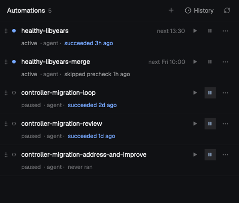

# Automate everything

**Run scripts and AI agents on a schedule from Herdr.** They keep running on time
even when the app is closed.



A few things you could set up:

- Every weekday at 9:00, run a script that pulls the latest code in all your repos.
- Every morning, have Claude review yesterday's merged pull requests in a fresh
  worktree and leave a summary.
- Every hour during work hours, have an agent check for failing builds, but only
  start it when there's actually something to look at.

## Getting started

1. Clone this repo anywhere and copy the mod into Herdr:

   ```sh
   git clone https://github.com/lucasprag/herdr-automate-everything ~/Projects/herdr-automate-everything
   ~/Projects/herdr-automate-everything/scripts/install-mod.sh
   ```

   Or ask your coding agent to add the mod from
   [`app/mods/automate-everything`](app/mods/automate-everything) in this repo.

2. Open **Automations** in Herdr's side panel. The first time, it downloads
   its program from the repo's releases and installs it in the background,
   which takes a few seconds. Nothing else to install.
3. Click **+**, give the automation a name, pick **Script** or **Agent**, set a
   schedule and save.
4. Click the play button next to it to try it right away instead of waiting
   for the schedule.

From then on it runs by itself. To update, `git pull` and run
`scripts/install-mod.sh` again; the panel installs the new program within
5 minutes.

### On Linux, without the Herdr app

The scheduler, script automations and the command line also run on Linux
(tested on Ubuntu), as a systemd user service instead of a launchd agent. You
don't need the Herdr app for script automations; you configure them with the
command line or by editing the config file.

1. Get the program into `~/.local/bin`, either the release binary for your
   machine (static, so it runs on any distro):

   ```sh
   arch=$(uname -m)   # x86_64 or aarch64
   mkdir -p ~/.local/bin && cd ~/.local/bin
   curl -fsSLO https://github.com/lucasprag/herdr-automate-everything/releases/latest/download/automate-everything-linux-$arch
   curl -fsSLO https://github.com/lucasprag/herdr-automate-everything/releases/latest/download/automate-everything-linux-$arch.sha256
   sha256sum -c automate-everything-linux-$arch.sha256 && mv automate-everything-linux-$arch automate-everything && chmod +x automate-everything
   ```

   or a build of this repo (needs [rustup.rs](https://rustup.rs)):

   ```sh
   cargo build --release && cp .target/release/automate-everything ~/.local/bin/
   ```

2. Install and start the service, then check on it:

   ```sh
   automate-everything service install
   automate-everything status
   ```

   This writes `com.lucasprag.automate-everything.service` in
   `$XDG_CONFIG_HOME/systemd/user/` (`~/.config/systemd/user/` by default)
   and enables it with `systemctl --user`. It needs systemd 240 or newer with a
   user instance; on WSL without systemd, or OpenRC/runit distros, keep
   `automate-everything scheduler` running some other way.

3. A systemd user service stops when you log out, unless lingering is on for
   your user. `status` (and `service install`) warn when it's off; turn it on
   with:

   ```sh
   loginctl enable-linger $USER
   ```

4. Add an automation and try it:

   ```sh
   automate-everything set hello --create --fields '{"kind":"script","schedule":"*/5 * * * *","command":"date"}'
   automate-everything run hello --wait
   ```

Agent automations need herdr-core (`hc`) and the agent (`claude`) on the PATH
your login shell sets up; they haven't been tested on Linux yet.

#### Managing it from your Mac

If the Linux machine is a herdr-core machine your Mac knows (`hc machine ls`),
you can manage its automations from the Mac: in the Automations panel, or with
`--on`:

```sh
automate-everything machines --probe            # which machines run it, and which version
automate-everything --on lab list
automate-everything --on lab run hello
automate-everything --on lab history hello
```

Its entries show in the panel in their own group, "Scheduled by lab", with
run now, pause, resume, edit, delete and history working as for this Mac's.
They keep running while the Mac sleeps or is off. If the machine can't be
reached the group says so, with when it was last seen, and its buttons do
nothing until it's back. See [Scheduled by another machine](#scheduled-by-another-machine).

## What's in this repo

| Path | What it is |
|---|---|
| `src/`, `Cargo.toml` | The `automate-everything` program (Rust): scheduler, runner, command line |
| `app/mods/automate-everything/` | The Herdr mod: the Automations panel, `install.sh` and the agent skill |
| `scripts/install-mod.sh` | Copies the mod into `~/.config/herdr-app/mods/` |
| `docs/requirements.md` | What it has to do |

## Scripts and agents

A **script** automation runs a shell command, like `~/bin/backup-notes`. You
don't see it run. Its output and whether it worked go into the history.

An **agent** automation starts Claude (or another coding agent) with a prompt
you write, in a repo you pick. It opens in a new space in Herdr, so you can
watch it work or check on it later. When the agent finishes, its space closes
by itself. If something goes wrong, the space stays open so you can see what
happened.

Use a script when a command can do the job. Use an agent when the work needs
judgement.

A few options make agents nicer to live with:

- **New worktree per run** gives the agent its own copy of the repo, so it never
  touches what you're working on. The worktree is deleted afterwards.
- **One shared space** puts every run as a tab in a single space, which is handy
  for agents that run often so they don't fill up your sidebar.
- **Precheck** is a quick command that decides whether the agent should start at
  all. If it exits with 0, the agent runs; otherwise the run is skipped. That
  way you don't pay for an agent that has nothing to do.

Write agent prompts so the agent can finish without asking you anything.
Nobody is there to answer when it runs at 7 in the morning.

## Schedules

Schedules use cron's five fields: minute, hour, day of the month, month and
day of the week.

| Schedule | Runs |
|---|---|
| `0 9 * * *` | every day at 9:00 |
| `30 8 * * 1-5` | weekdays at 8:30 |
| `0 9-17 * * 1-5` | every hour from 9:00 to 17:00 on weekdays |
| `*/15 * * * *` | every 15 minutes |
| `0 7 1 * *` | at 7:00 on the first of every month |
| `@daily` | every day at midnight (also `@hourly`, `@weekly`) |

Times are in your computer's timezone unless you set another one.

If your computer was asleep when an automation was due, it runs once when it
wakes up, as long as that's within 10 minutes of the scheduled time (you can
change that with **Grace**). Otherwise the run is recorded as missed and waits
for its next time.

## The panel

Each automation has three buttons:

- **Play** runs it now.
- **Pause** stops it from running on its schedule until you click it again.
- **...** lets you edit or delete it. Deleting also deletes its history.

To change the order, drag an automation up or down by the dotted handle on its left.

**Scheduled by another machine:** an automation that runs on a machine running
automate-everything itself can be scheduled by that machine instead (**Scheduled
by** in the edit form), so it fires while this Mac sleeps. Those show below this
Mac's, in a group per machine, refreshed every minute. A machine that can't be
reached is marked as such and its buttons do nothing until it's back.

**History** lists every run, other machines' included. Click one to see what happened: when it ran, how
long it took, its output and, for an agent, what was on its screen at the end.

| Status | What it means |
|---|---|
| succeeded | It worked. |
| failed | The command returned an error, the run took too long, or the agent quit before finishing. |
| blocked | The agent stopped to ask you something. Go to its space and answer. |
| closed | You closed the agent's space yourself. |
| skipped precheck | The precheck said there was nothing to do. |
| skipped overlap | The previous run was still going, so this one didn't start. |
| missed | The computer was asleep or off at the scheduled time. |

## Asking your agent

The mod comes with a skill that teaches Claude, Codex and other agents how to
work with your automations. Once it's installed you can just ask things like:

- "Is my backup automation working? Why did it fail yesterday?"
- "Move the PR review to 8:00 and only run it on weekdays."
- "Pause everything until Monday."
- "Schedule an agent that cleans up stale branches every Friday."

The skill is linked into `~/.claude/skills` and `~/.agents/skills` when the mod
installs, unless you already have a skill with that name.

---

# Reference

The rest of this file is for when you want to edit the config by hand, use the
command line, or work on the mod itself.

## How it fits together

- **`automate-everything`**, a Rust program (`src/`), does the real work: it
  keeps the schedule, starts the runs, stores the config and the history, and
  has a command line for all of it. It runs as a background service (a launchd
  agent on macOS, a systemd user service on Linux), which is why automations
  fire with the app closed.
- **The Automations panel** (`app/mods/automate-everything/`) is a view on
  top of that program. Anything you do in the panel goes through the command
  line, so the two always agree.

When the panel loads, and every 5 minutes after, it runs `install.sh`. That
downloads the released program for this version (or builds it, see Working
on the mod), copies it to
`~/.local/bin/automate-everything`, sets up and starts the background service,
and links the agent skill. Each step only runs when something changed. Runs in
progress keep going through an update. Install problems show in the panel; the
log is `~/.config/herdr-app/mods/automate-everything/.target/install.log`.

To uninstall the background service: `automate-everything service uninstall`.

On Linux the release binary is static (musl), so it reads `/etc/passwd`
directly and doesn't see directory users (LDAP, SSSD). If you're one and the
service starts without `$SHELL`, runs use `/bin/sh` for the login environment;
build from source instead to use your system's NSS.

Requirements: [docs/requirements.md](docs/requirements.md).

## Where things live

| What | Where |
|---|---|
| Config | `~/.config/automate-everything/automations.toml` |
| History, locks, logs | `~/.local/state/automate-everything/` (`runs/<id>/run.json`, `stdout.log`, `stderr.log`, `agent.log`) |
| Background service | macOS: `~/Library/LaunchAgents/com.lucasprag.automate-everything.plist`; Linux: `$XDG_CONFIG_HOME/systemd/user/com.lucasprag.automate-everything.service` (default `~/.config`) |
| Worktrees | `~/.herdr/worktrees/<repo>/automation/<name>/<stamp>` (on the run's machine) |

## Config file

One `[automations.<name>]` table per automation. You can edit the file by
hand; the service rereads it every minute, and `automate-everything check`
tells you if something is wrong. The panel and the command line only rewrite
the automation they change, so your comments and order stay put.

```toml
[settings]
retention_days = 30            # history ages out after this
max_runs_per_automation = 200

[automations.say-hello]
kind = "script"                # script | agent
schedule = "30 8-15 * * 1-5"   # cron, 5 fields; @hourly/@daily/@weekly too
timezone = "America/Toronto"   # default: this computer's
grace_minutes = 10             # a fire missed by more than this is recorded as missed
paused = false
command = "~/bin/hello --loud" # run by /bin/sh with your login environment
cwd = "~/Projects"             # default: home
timeout_seconds = 3600
env = { GREETING = "hi" }

[automations.nightly-review]
kind = "agent"
schedule = "0 7 * * 1-5"
repo = "~/Projects/my-app"
directory = "worktree"         # repo (default) | worktree: a new git worktree per run
base_branch = "origin/main"    # worktree only; fetched first
space = "per-run"              # per-run (default) | shared: tabs in one space named space_name
space_name = "Nightly review"  # default: the automation's name
agent = "claude"               # default claude
model = "opus"                 # passed as --model
agent_args = ["--effort", "high"]
prompt = """Review yesterday's merged PRs..."""   # or prompt_file = "~/prompts/review.md"
precheck = "~/bin/anything-to-review"   # scheduled runs only: exit 0 runs, anything else skips
precheck_timeout_seconds = 120
timeout_seconds = 10800
```

Every run gets the environment variables `HERDR_AUTOMATION`,
`HERDR_AUTOMATION_RUN_ID` and `HERDR_AUTOMATION_TRIGGER` (`scheduled` or
`manual`).

### Running on another machine

`machine` runs an entry on another herdr-core machine, one that
`hc machine ls` lists. Its `command`, `cwd`, `repo`, `precheck` and
`prompt_file` are paths on that machine, `~` being its home. Leave it out to
run on this Mac.

```toml
[automations.lab-probe]
kind = "script"
schedule = "*/30 * * * *"
machine = "lab"                # default: this Mac
command = "uname -a; hostname"
```

### Scheduled by another machine

With `machine` set, this Mac's scheduler fires the run and the run executes on
the machine, so nothing runs while this Mac sleeps. To have the machine keep
the schedule itself, put the entry in *its* config instead: the machine needs
automate-everything installed with its service running (see [On Linux, without
the Herdr app](#on-linux-without-the-herdr-app)).

From this Mac, `--on <machine>` runs any command there, through `hc exec`:

```sh
automate-everything --on lab set lab-probe --create --fields '{"kind":"script","schedule":"*/30 * * * *","command":"uname -a"}'
automate-everything --on lab list
```

On the machine it's an ordinary local entry: no `machine` field, paths, `~`
and the environment are its own, and its runs and history stay there. An empty
`timezone` means the machine's own, so the panel writes this Mac's in when you
leave it empty.

`transfer` moves an entry between the two schedulers. It creates the entry on
the target paused, removes it from the source, then resumes it, so it never
fires from both and is never in neither (if the removal fails, the copy is
removed again). History stays where it was.

```sh
automate-everything transfer lab-probe --to lab          # lab schedules it from now on
automate-everything --on lab transfer lab-probe --to here   # back to this Mac (machine = "lab")
```

`--on` needs the same release on both sides (`machines --probe` shows each
machine's version), and it never waits on an offline machine: one hc doesn't
show as connected fails at once, and calls time out after 10 s (30 s for
changes). A field the machine's version doesn't know is refused there, and
nothing is written.

## How runs behave, in detail

- **Scripts** run in the background with no space. Output and exit code go into
  the run's record.
- **Agent runs** open a terminal through herdr-core, labelled with Herdr's space
  and tab ids, so they show up as a space (or a tab in the shared space) even
  when the window is closed. The agent runs inside a login shell that stays
  after the agent ends, so a failed run's space still shows what happened.
- **Finished means finished:** the agent has to take the prompt (its first turn
  starts, or it shows as working), then report done or idle with its process
  still alive for about 10 seconds.
- **Success closes what the run opened:** its space, if the run made it and
  every terminal there belongs to this run (`automation.run=<id>` label);
  otherwise only its tab.
- **Failure stays open.** An agent that never takes the prompt within 3 minutes
  has its space closed. An agent that exits early or hits its timeout leaves
  the space open (the agent is stopped, its shell stays).
- **Blocked hands the run to you:** no timeout and no auto-close. It ends as
  succeeded when the agent finishes (the space stays open, since you stepped
  in) or closed when you close the space.
- **Worktrees** are removed with `git worktree remove` once the run's space is
  gone, including spaces you close by hand. The branch is deleted only if it
  has no new commits or they're merged or pushed; otherwise the record says
  why it was kept.
- **Claude's folder-trust question** shows up for every new worktree. For the
  worktree the run just made from the configured repo, and only that one, the
  runner answers yes and notes it in the record.
- **One run at a time** per automation, held by a lock for as long as the run
  lasts, a blocked one included. A scheduled time that comes up meanwhile is
  recorded as skipped overlap.
- **On another machine** the run gets that machine's login environment, not
  this Mac's. A script's output comes back into its record as usual, and a
  timeout stops it there. An agent's space shows under that machine. If the
  machine can't be reached, the run fails and says so. Scheduling stays on
  this Mac, so nothing runs while it sleeps, unless the machine schedules it
  itself ([Scheduled by another machine](#scheduled-by-another-machine)).
- **Catching up after sleep:** the newest missed time runs once if it's inside
  the grace window; otherwise one missed record covers them all. Daylight
  saving: a fixed-time automation runs once when clocks go back and isn't lost
  when they go forward.

## Command line

```
automate-everything list | run <name> [--wait] | pause <name> | resume <name> | delete <name>
automate-everything move <name> --to <position>
automate-everything history [<name>] | show <run-id>
automate-everything get <name> | set <name> --fields '<json>' [--create] | check
automate-everything status | machines [--probe] | service install|uninstall|restart | scheduler
automate-everything transfer <name> --to <machine>|here
automate-everything --on <machine> <any of the above>
```

Add `--json` to `list`, `history`, `show`, `check` and `machines` for
machine-readable output. `delete --keep-history` removes only the entry.

### Extra tabs from an agent run

An agent run can open more tabs in its own space, for a helper agent or a shell
in another worktree, and close them when they're done:

```
automate-everything tab open --name <tab> --cwd <dir> [--space <id> | --new-space <name>] [--label k=v] [--trust] [--wait-start] [-- <program> <args>]
automate-everything tab close --label k=v [--except-self] | tab close --self
```

The tab opens in the caller's space, or `--space <id>`; `--new-space <name>`
opens it as the first tab of a new space with that name (its id is `space` in
the printed JSON), so a run can give a piece of work its own space.
`--trust` answers Claude's folder-trust question for `--cwd` only.
`--wait-start` waits until the agent has taken its prompt. `tab close` only
closes tabs opened with `tab open`, never the run's own tab or anything you
opened. When the run succeeds it closes its own tab; the tabs it opened stay
until they close themselves, and the space closes with its last tab.

## Panel keys

`keys.json` can send `automate-everything.history`, `.home`, `.new`,
`.edit:<name>`, `.menu:<name>` and `.run:<run-id>` to the panel.

## Working on the mod

Herdr runs the copy in `~/.config/herdr-app/mods/automate-everything`, not
this checkout. Edit here, then run `scripts/install-mod.sh` to copy the mod
over; Herdr reloads it right away. The script also records this checkout in
the copy, so you don't need a release to change the Rust part. The mod's
`install.sh` picks the program like this:

1. A copy with no checkout recorded (added by hand or by an agent) downloads
   the release for the version in `app/mods/automate-everything/VERSION`.
2. With a checkout whose `src/`, `Cargo.toml` and `Cargo.lock` match that
   version's tag, it downloads that release too.
3. Otherwise, if `cargo` is installed ([rustup.rs](https://rustup.rs)), it
   builds the checkout, so your changes are what runs, committed or not.
4. Without `cargo`, it downloads the latest release. Someone who pulls
   unreleased Rust changes keeps a working mod; the changes reach them with
   the next release.

Downloads are checked against their `.sha256`. A private repo needs `gh`
signed in.

To release, bump `version` in `Cargo.toml` and in
`app/mods/automate-everything/VERSION`, run `cargo build` so `Cargo.lock`
follows, commit, then tag and push:

```sh
git tag v0.2.0 && git push origin main v0.2.0
```

The release workflow (`.github/workflows/release.yml`) checks the tag matches
both versions, builds for Apple Silicon and Intel, joins them into one universal
binary, builds static Linux binaries for x86_64 and aarch64, and attaches them
and their checksums to a GitHub release. Everyone's panel
picks it up within 5 minutes of them pulling and running
`scripts/install-mod.sh`.

`cargo test` covers cron, daylight saving and config parsing. Point a test at
a sandbox with `AUTOMATE_EVERYTHING_CONFIG` and `AUTOMATE_EVERYTHING_STATE`.
`scripts/install-mod.sh` ends with `herdr-app check` on the copy.

## Contributing

Ideas, bug reports and pull requests are all welcome. If an automation did
something you didn't expect, or you wished the panel did something it
doesn't, open an issue and say what you expected. That alone helps.

Some bigger things that would be great to have:

- **Windows support.** A Windows service or Task Scheduler next to launchd
  and systemd (`src/service/`), plus Windows builds. Agent runs go through herdr-core, which also runs on
  Windows.

You don't need Rust to make a difference here. The panel is plain JavaScript
(`app/mods/automate-everything/`: `panel.js`, `edit.js`, `popups.js`) and Herdr
reloads it as soon as `scripts/install-mod.sh` copies it over.
Changes to the scheduler or the command line live in `src/`; with `cargo`
installed, your build is what runs, so you can try a change on your own
automations before sending it.

Before opening a pull request, run `cargo test` and `herdr-app check`, and try
the change in the app. If it changes how something behaves, update
[docs/requirements.md](docs/requirements.md) and this README to match.

Coding agents are good at this kind of change. Herdr's `AGENTS.md` (in
`~/.config/herdr-app`) teaches them how mods work, so open this folder in one
and describe what you want.

## License

[MIT](LICENSE)
