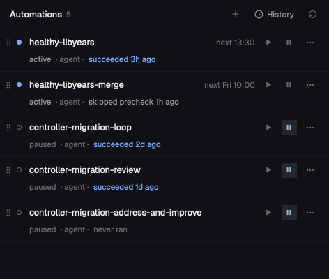

# Automate everything

A side panel that lists your scheduled automations, one line each. An automation is a shell script or a coding agent (Claude by default) that runs on a cron schedule. Each line shows whether it's active or paused, when it runs next and how its last run went, with buttons to run it now, pause it, edit it or delete it. A History page lists every fire and run, and a run opens to its details and output. Agent runs open in their own Herdr space. Automations keep running when the window is closed, because a background program (`automate-everything`, a launchd agent) does the scheduling and the panel only shows it.

## What you see

The panel fills a block, normally a side panel stack about 368px wide, on the theme's `chrome` background at text size 13.

- **Header, 42px, 1px `border` line below.** Home page: "Automations" (semibold) and a dim count, `5` or `5 · 1 running`, at 11.5. Then on the right a `+` button (new automation), a "History" button (clock icon + label, 12) and a refresh button that spins while it loads. The icon buttons are 26px squares, `dim`, with a `hover` background. History page: a back chevron, "History", and when the list is narrowed to one automation, a small bordered chip with its name and an `x`. Run page: back chevron and the automation's name.
- **Banner** (only when something's wrong), 11.5 in `blocked` color on its own line under the header. It shows, in this order: a CLI error, the last action's error, "Couldn't install the scheduler: …" with the install log's last three lines, or "Starting the scheduler…" while the background program isn't running.
- **Home page:** one line per automation in the config file's order, each with a 1px `border` line below, padding 8px vertically.
  - First line: a 12×20 drag grip (`dim`), a status mark, the name (12.8, `foreground`, truncates), "next 13:30" (11.5, `dim`), then three 22px buttons: play (run now), pause (pressed look, `accent` on `selected`, while paused) and `…` (edit or delete).
  - Second line, indented 36px, 11.5: the status in its color, `· agent ·` or `· script ·` in `dim`, then the last run, e.g. "succeeded 3h ago" in the run's color, or "never ran".
  - A config error for that entry shows as a third line in `blocked` color.
  - Status marks: a 7px filled dot in `done` for active; a hollow ring in `dim` for paused; a spinning spinner in `working` for running; a filled dot in `blocked` for blocked or invalid.
  - Empty: "No automations yet." and "Add one with + or in ~/.config/automate-everything/automations.toml."
- **History page:** every run, newest first. Each line has a mark, the automation's name and the time ("07:30" today, "Tue 07:30" this week, "Nov 3 07:30" older), then the status word and `· scheduled · agent · 4m 12s` (trigger, kind, duration, missed or caught-up fires). Empty: "Nothing has fired yet."
- **Run page:** label/value rows (label column 84px, `dim`): Status, Trigger, Scheduled, Missed, Caught up, Started, Finished, Duration, Exit, Timed out, Note, Agent, Space, Closed, Worktree. Only the rows with a value show. If the run's space is still open: a solid button "Go to its space", or "Go to its space (it needs you)" when blocked. Then a Precheck section, if there is one, and the output blocks (stdout, stderr, agent output) in JetBrains Mono 11 on the `background` color with a border, cut to the last 400 lines.
- **Popups**, all square (`frame: "none"`) with a 1px `border` and a shadow, on `popover`:
  - `…` menu, 180px wide: "Edit", and "Delete…" in `blocked`. Rows are 30px tall.
  - Delete confirmation, 420×170 dialog: "Delete <name>?", "Removes it from automations.toml and deletes its run history. Its open spaces stay.", then Cancel and a `blocked` Delete button.
  - Edit form, 640px wide and 86% of the window tall: "New automation" or "Edit <name>", with "Cmd+Enter: save · Esc" on the right. The fields scroll; Cancel and Save sit at the bottom.

## How it behaves

- **Clicking an automation's line** opens History narrowed to it. Clicking a run opens its page. The chip's `x` clears the narrowing.
- **Play** runs it now (disabled while it's running). **Pause** toggles paused/active. **`…`** opens the menu. None of these buttons start a drag or open the history.
- **Dragging the grip** 4px starts a reorder: the list shows the new order live, and releasing writes it to the config. Leaving the list cancels the drag.
- **Edit form:** Name (only when creating), then Kind (Script | Agent as a segmented control). Every kind gets Description, Schedule, Timezone and Grace (minutes). A script adds Command and Folder. An agent adds Repo, Runs in (The repo | New worktree per run), Base branch (worktree only), Space (New space per run | One shared space), Space name, Agent, Model, Agent args, Prompt (multi-line), Prompt file, Precheck and Precheck timeout. Every kind ends with Run timeout and Environment (`KEY=value` lines, monospaced). Save sends only the fields that changed; a cleared field is removed. The background program validates the entry, and its error shows above the buttons without writing anything.
- **Statuses** come from the background program: active, paused, running, invalid (a config error), and blocked while an agent run waits for the person. Runs end as succeeded, failed (a timeout is a failed run marked "Timed out"), skipped overlap, skipped precheck, missed or closed.
- **It stays current:** it refreshes every 15 seconds and as soon as anything changes in `~/.config/automate-everything` or `~/.local/state/automate-everything`.
- **It installs itself:** when the panel loads and every 5 minutes after, it runs the mod's `install.sh` in the background. That script gets the program (the GitHub release for the version in `VERSION`, or a cargo build of a source checkout recorded in `.target/source`), puts it in `~/.local/bin/automate-everything`, and writes and starts the launchd agent `com.lucasprag.automate-everything`. It also links the skill in `skills/automate-everything` into `~/.claude/skills` and `~/.agents/skills` unless something has that name already. Each step runs only when something changed.
- **Commands it takes** (from `keys.json` or other mods): `automate-everything.history`, `.home`, `.new`, `.edit:<name>`, `.menu:<name>`, `.run:<run-id>`.

## Built from

- **One mod, `automate-everything`,** with `mod.json` `{ "place": "none", "title": "Automate everything" }`. `main.js` picks a view from `props().view`: none is the panel (`panel.js`), `menu` and `confirm` are the popups (`popups.js`), and `edit` is the form (`edit.js`). The popups are opened with `openOverlay({ mod: "automate-everything", frame: "none", kind, props: { view, name } })`.
- **All data goes through the program's command line** (`cli.js`, which runs `~/.local/bin/automate-everything` with `exec`): `list --json`, `status --json`, `history --json --limit 200`, `show <id> --json`, `get <name>`, `run <name> --json`, `pause`, `resume`, `delete <name> --yes`, `move <name> --to <n>`, and `set <name> --fields '<json>' [--create]`. The panel never writes the config or the history itself.
- **`herdr` functions:** `theme`, `props`, `settings`, `openOverlay`, `closeOverlay`, `run` (`space.select` for "Go to its space"), `spaces`, `home`, `appHome`, `watchFolder`, `nextCommand`, `exec`, `readTextFile`.
- **`gpui-base`:** `v_flex`, `h_flex`, `InputState`/`Input`, `TextareaState`/`Textarea`.
- **Icons:** its own `automations.svg`, `refresh.svg`, `grip.svg`, `play.svg`, `pause.svg` and `dots.svg`, plus `chevron-left`, `plus`, `clock`, `x` and `spinner` from the shipped `workspace-chrome` mod.
- **Programs it runs:** `/bin/sh install.sh` (detached with `nohup`), which uses `curl` or `gh` to download from GitHub releases, `shasum` to check them, `cargo` when building a checkout, and the program's `service ensure`, which drives `launchctl`. The program then runs your scripts with `/bin/sh` and starts agents through herdr-core (`hc`), labelling their terminals so they show as Herdr spaces and tabs.
- **The program** is Rust, in this repo's `src/`. Releases are one universal macOS binary plus its `.sha256`.

## Watch out

- **No panel until a layout has a block for it.** `"place": "none"` keeps Herdr from docking it on its own. Add `{ "id": "automations", "type": "block", "content": { "mod": "automate-everything" } }` to a stack (the shipped `main` layout's `panel-body` works) and a button that runs `layout.select { stack: "panel-body", child: "automations" }` and `layout.show { id: "panel" }`. That means cloning `main` and `tabs` first, because shipped layouts and mods are read-only.
- **Tell the person before adding it:** it reaches the network (GitHub releases), runs programs, installs a binary in `~/.local/bin`, and writes a launchd agent that starts at login. It reads and writes `~/.config/automate-everything` and `~/.local/state/automate-everything`.
- **macOS only:** the scheduler is a launchd agent, and the releases are macOS binaries.
- **Run-time files go only under the hidden `.target/`** (install log, status, downloads, source path). Any other file written into the mod folder makes Herdr reload the mod and reset its state.
- **`install.sh` runs detached** because a first build can take longer than `exec` allows. The panel learns the result from `.target/install.status` (0 or 1) and `.target/install.log`.
- **Keep it a copy, not a symlink:** Herdr doesn't reload a mod behind a symlink. `scripts/install-mod.sh` copies it and records the checkout.
- **`VERSION` must match a published release** (and `Cargo.toml`; `release.yml` checks both), or a plain copy has nothing to download and falls back to the latest release.
- **The `workspace-chrome` icons** must exist under that name. A setup that renamed or removed the shipped mod shows blank buttons.

## Done when

- `herdr-app check` passes on `mods/automate-everything`.
- With the panel shown, `.target/install.status` reads `0` within a minute and `automate-everything status --json` reports `"scheduler_running": true`.
- `+` opens "New automation". Saving a Script named `hello` with command `echo hi` and schedule `* * * * *` adds `[automations.hello]` to `~/.config/automate-everything/automations.toml`, and the line shows with a filled dot and "next HH:MM".
- Play on `hello` runs it: the line reads "succeeded … ago", and its run page shows Exit `0` and stdout `hi`.
- Pause turns the dot into a ring and drops "next"; pressing it again brings them back.
- Dragging `hello` above another automation changes the order in the TOML file.
- Delete… then Delete removes `hello` from the file and the panel.
